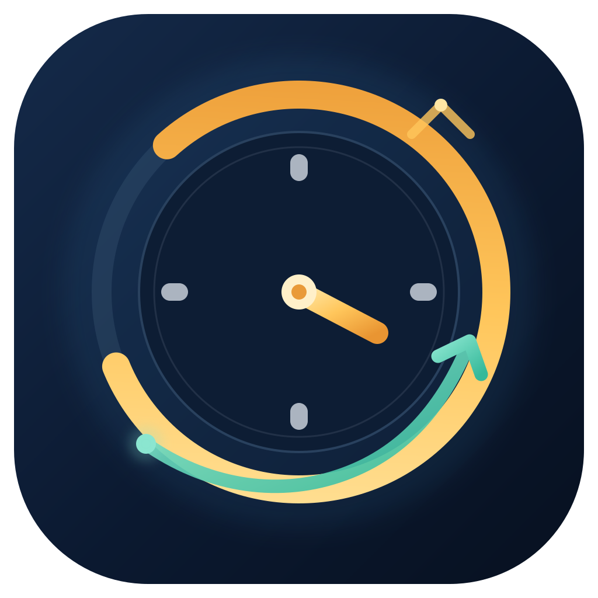
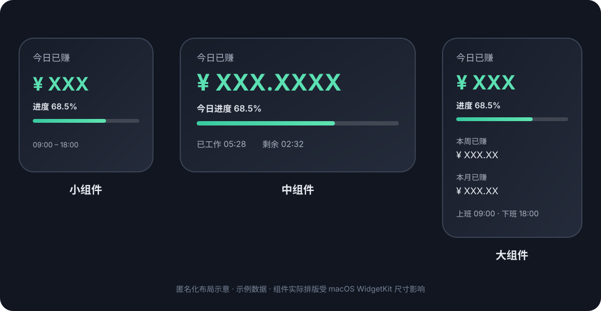
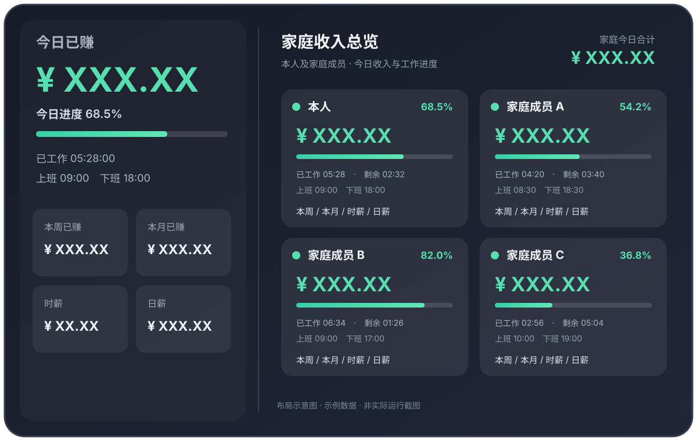
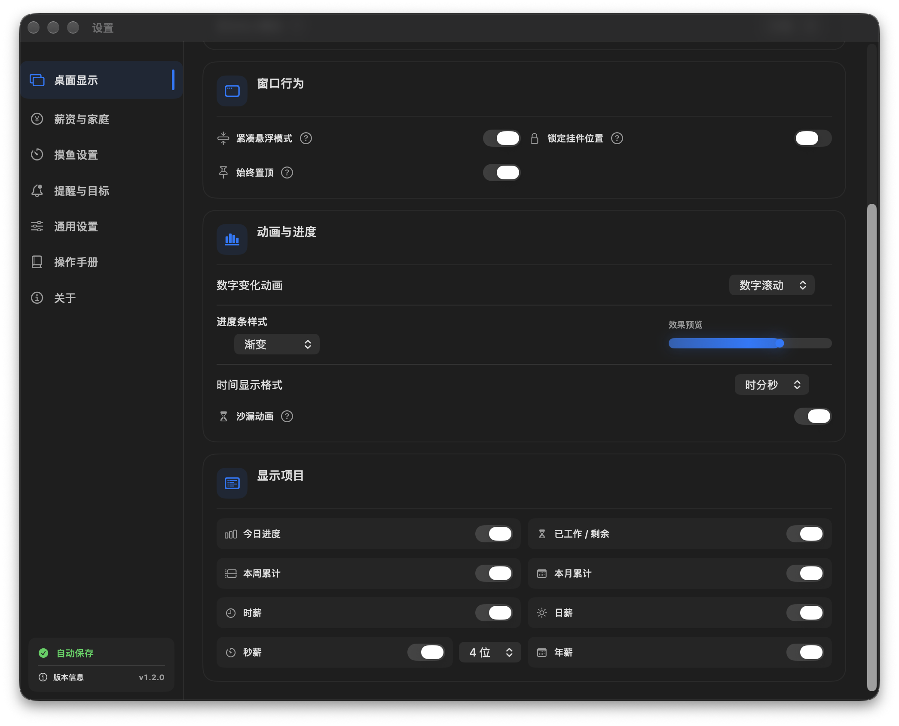
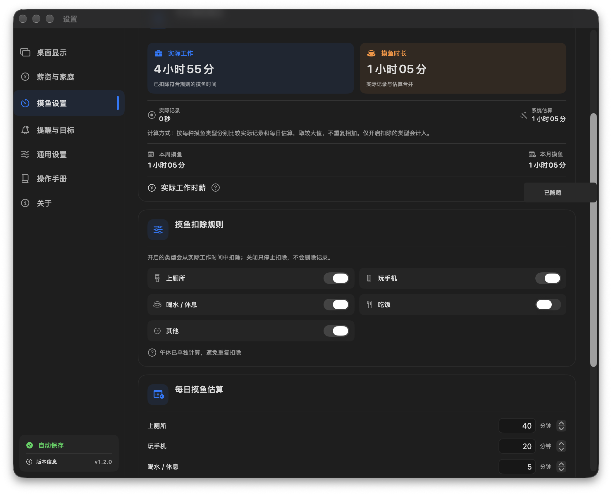

# 薪资时钟 · Salary Clock

<p align="center">
  
</p>

<p align="center">
  macOS 原生薪资时钟与家庭收入桌面组件
</p>

<p align="center">
  
  
  
  
</p>

**当前版本：1.2.0**

版本变更记录见 [CHANGELOG.md](CHANGELOG.md)。


一款基于 SwiftUI、AppKit 与 WidgetKit 的 macOS 原生薪资时钟。它根据月薪、工作日历、上下班时间和午休时段，持续估算今日、本周和本月收入；也可以把家庭成员加入收入总览，在桌面组件中查看每个人的今日收入与工作进度。当前版本仅支持 macOS。

## 界面预览

项目提供悬浮薪资窗口，以及小、中、大、超大四种桌面 Widget。超大组件采用家庭仪表盘布局，可根据可用空间自动切换纵向或横向排列。

> 说明：以下为根据当前界面结构绘制的匿名化效果示意，不包含真实姓名、薪资或个人桌面信息。实际显示会随组件尺寸、主题和显示设置变化。

| 悬浮窗口 | 小 / 中 / 大 Widget |
| --- | --- |
|  |  |

**超大家庭收入总览**



### 1.2.0 设置界面实机截图

以下为 macOS 应用 1.2.0 的实际设置窗口截图。摸鱼设置截图中的实际工作时薪已做隐私遮挡；其他界面内容来自本机运行版本。

| 桌面显示 | 摸鱼设置 |
| --- | --- |
|  |  |


## 功能

### 桌面悬浮窗口
- SwiftUI + AppKit 原生 macOS 无边框面板，支持普通桌面层级或可配置始终置顶，可拖动
- 位置锁定：通过挂件锁形按钮或设置开关锁定 / 解锁；未锁定时拖动挂件顶部左侧文字区域移动窗口
- 无关闭、最小化、最大化按钮；通过菜单栏图标或应用菜单隐藏 / 恢复
- 支持 `Option + Command + H` 快捷键隐藏 / 恢复挂件
- 紧凑模式默认显示主指标及辅助指标；金额模式显示进度条，进度模式显示今日金额；鼠标移入后根据挂件在屏幕中的垂直位置智能选择向上或向下展开，避免内容被屏幕边缘遮挡；展开状态可直接切换紧凑模式
- 支持按社保、公积金缴费基数与个人缴费比例，以及专项附加扣除估算税后工资，并选择按税后工资计算收入
- 数字变化支持数字滚动、平滑淡变两种动画；金额、累计收入、税费和百分比等数字统一使用千位分隔符
- 家庭成员薪资：可添加多位成员，分别设置姓名和月薪，在挂件中并列展示今日实时收入；共享当前工作日历与工时规则
- 愿望清单：记录目标金额、已存金额和完成进度
- 下班状态：到达个人设置的下班时间后，今日已赚金额和 100% 工作进度继续保留，同时以红色显示累计加班时长；悬浮窗与所有 Widget 尺寸保持一致，家庭成员分别按各自下班时间切换；休息日和法定节假日不累计加班
- 关于与版本信息：设置中新增「关于」页面，展示应用名称、版本号和构建版本，版本信息直接读取应用构建配置
- 下班提醒：支持每日自定义时间，通过 macOS 系统通知提醒
- 隐私模式：一键遮罩挂件中的今日、本周、本月收入及日薪 / 时薪
- 内容自适应窗口高度，窗口尺寸以挂件内容为准
- 金额 / 进度百分比两种主显示模式：进度模式以百分比为主、今日金额为辅；金额模式以收入为主、进度为辅
- 6 种主题：深空、纸感、霓虹、海盐蓝、日落橙、石墨灰
- 背景透明度调节
- SVG 矢量应用图标：`Resources/AppIcon.svg`，构建时生成 macOS 多尺寸 ICNS，并供应用与系统通知使用
- 设置窗口支持 `⌘ + ,` 显示 / 隐藏；界面自动保存，无额外完成按钮
- 界面语言：简体中文、繁体中文、English；应用界面语言在设置中选择并自动保存。日期和时间格式采用 macOS 当前 Locale，跟随系统「语言与地区」设置
- 金额支持 0–6 位小数、百分比支持 0–4 位小数；秒薪独立支持 0–6 位小数，默认 4 位；可编辑金额、数量和时间均支持键盘直接输入，选择器/步进器仅作辅助；桌面窗口约每 100ms 更新一次
- 统计信息可分别开关，支持精简显示

### 收入统计
- 今日已赚取金额 / 今日工作进度
- 本周累计收入、本月累计收入
- 日薪、时薪
- 今日进度百分比、可选圆角实心/渐变/分段/细线样式的进度条、已工作时间和剩余时间
- 本月计薪工作日数量
- 每项统计都可以在设置中独立开关

### 摸鱼统计与有效工时
- 默认关闭，可在「摸鱼设置」启用；仅记录用户主动开始/结束的休息，不监控键盘、鼠标或屏幕。
- 支持上厕所、玩手机、喝水/休息、吃饭和其他类型，可在悬浮窗开始/结束记录，也可手动补录历史时间段。
- 每种类型可独立设置是否从实际工作时间中扣除，并可配置每日估算分钟数；估算只在工作日随计划工作时间逐步累计。
- 实际记录与每日估算按类型分别取较大值，不重复相加；关闭某类型扣除只停止扣除，不删除历史记录。
- 设置页展示今日实际工作、摸鱼时长、实际记录、系统估算、本周/月累计及实际工作时薪；记录仅保存在本机。

### 薪资与日历
- 自定义月薪、每周工作日和上下班时间；小时、分钟可直接键盘输入
- 午休采用本人及家庭成员独立开关：默认关闭，开启后才显示午休时间配置；开启时午休区间从有效计薪工时中扣除
- 支持国务院公布的 2026、2027 年节假日及调休补班安排
- 可关闭中国节假日日历，退回每周工作日规则
- 旧版本本地设置可自动迁移，新字段使用默认值补齐

### macOS 原生桌面 Widget
- 基于 WidgetKit，支持小、中、大、超大四种桌面组件尺寸；超大组件采用家庭仪表盘布局：先展示本人的今日收入、进度、工作时长、上下班时间及统计项，再展示本人和全部家庭成员的收入卡片；每张成员卡片包含今日收入、进度百分比、进度条、已工作/剩余时间、上下班时间，以及本周、本月、时薪和日薪。组件根据可用宽高自动切换纵向或横向排版
- 与悬浮挂件共用薪资计算逻辑和设置数据
- 通过 App Group 读取主程序配置；设置修改后主动请求刷新 Widget
- 遵循主题、金额/进度模式、隐私模式、语言及统计项显示开关；所有尺寸均不显示状态提示语，主金额下方固定显示今日进度百分比，并展示配置的上班/下班时间
- Widget 内容使用 SwiftUI `TimelineView` 请求每 5 秒重新计算并重绘时间相关数据；WidgetKit Provider 同时提供未来一小时的分钟级时间线，供系统调度后续更新
- 5 秒是尽力更新目标，不是系统保证；macOS 可能因 WidgetKit 的刷新策略、设备状态或资源管理而降低频率或延迟绘制

## 计算口径

- 当月计薪工作日：按每周工作日规则计算，并由已内置的官方节假日/补班安排覆盖
- 日薪 = 月薪 ÷ 当月计薪工作日数量
- 时薪 = 日薪 ÷ 当日有效工作小时数
- 今日收入 = 日薪 × 今日有效工作时间进度
- 本周 / 本月累计 = 已完成工作日收入 + 今天实时进度对应收入
- 午休不计薪
- 当前按固定上下班时间计算，不支持跨午夜班次
- 未单独计算加班费、请假扣薪和年终奖个税

## 应用内操作手册

设置窗口采用简洁的单层分类导航：桌面显示、薪资与家庭、摸鱼设置、提醒与目标、通用设置、操作手册和关于。左侧导航只显示分类名称，右侧卡片和设置项不重复显示小字副标题；复杂规则通过就近的问号帮助查看。窗口可调整大小，内容区域独立滚动，确保家庭成员等长列表在大窗口和小窗口下均可查看。主显示内容、金额精度和百分比精度统一归入“桌面显示 → 主显示”，薪资与家庭仅管理人员薪资、工作制度、工作时间和税后计算。桌面挂件默认位于桌面层级，普通应用窗口会显示在它前方；需要覆盖其他应用时，可在“桌面显示”开启“始终置顶”。挂件仅显示在当前桌面空间，不会自动跨所有桌面空间显示。设置窗口的“操作手册”按功能提供可搜索的操作说明，覆盖薪资与主显示、金额精度、工作制度、法定节假日、上下班与午休、税后工资、家庭成员、桌面统计、时间格式、紧凑模式、拖动锁定、动画、愿望清单、下班提醒、隐私、主题、语言、计算口径及 WidgetKit。复杂计算和开关影响通过设置项旁的问号说明，避免常驻解释文字挤占设置空间。

**首次使用：** 设置页首次打开时展示引导卡片；月薪、每周工作日、上班时间和下班时间为必填项（以红色 * 标识），每周至少选择一个工作日。秒薪默认显示 4 位小数，可在“桌面显示”秒薪开关右侧直接设置 0–6 位精度。

**强制开发约定：仓库根目录 `AGENTS.md` 是后续开发必须遵守的项目规范。所有用户可见功能默认必须同时覆盖 macOS 悬浮窗和 WidgetKit 桌面组件；所有时间、日期、金额、数量等可编辑数据必须支持键盘直接输入，不能只提供 Picker/Stepper。每次新增、删除或修改功能时，必须在同一变更中同步更新 README、应用内操作手册（`SettingsView.swift`）、独立操作手册（`docs/操作手册.md`）和 CHANGELOG。** 更新文档时同步检查设置路径、默认行为、开关影响、两端表现、输入校验、限制条件和示例，避免文档与实际行为不一致。

## 项目结构

- `Sources/SalaryClock/SalaryCalculator.swift`：薪资计算、工作日历和配置模型
- `Sources/SalaryClock/SalaryClockModel.swift`：状态更新和本地持久化
- `Sources/SalaryClock/FloatingWidgetView.swift`：桌面悬浮窗口
- `Sources/SalaryClock/SettingsView.swift`：设置界面
- `WidgetExtension/SalaryClockWidget.swift`：WidgetKit 扩展源码及 5 秒级尽力重绘逻辑
- `docs/images/`：Widget 界面布局示意图及 1.2.0 设置界面实机截图（薪资信息已遮挡）
- `docs/操作手册.md`：独立用户操作手册
- `AGENTS.md`：强制开发规范，约束悬浮窗/Widget 功能覆盖、键盘直接输入及文档同步
- `Configuration/*.entitlements`：App Group 权限配置
- `scripts/check-calculator.swift`：计算逻辑回归检查脚本
- `scripts/build-mac.sh`：兼容入口，转交 Xcode 完整构建（包含 WidgetKit）
- `project.yml`：XcodeGen App + Widget Extension 工程定义
- `SalaryClock.xcodeproj`：已生成的 Xcode 工程
- `scripts/build-xcode.sh`：生成/更新 Xcode 工程并构建完整应用包

## 构建 macOS 应用

需要 macOS、Xcode、XcodeGen 和已配置的 Apple Development 签名。主程序、WidgetKit 扩展、App Group、应用图标及本地化资源统一由 Xcode 工程构建：

```bash
brew install xcodegen
./scripts/build-xcode.sh
```

兼容旧命令也会转交同一套 Xcode 构建，不再使用缺少团队签名的 SwiftPM ad-hoc 打包方式：

```bash
./scripts/build-mac.sh
```

## 计算逻辑检查

```bash
swiftc -parse-as-library Sources/SalaryClock/SalaryCalculator.swift Sources/SalaryClock/WorkBreakRecord.swift Sources/SalaryClock/NumericFormatting.swift scripts/check-calculator.swift -o /tmp/salary-clock-calculator-check
/tmp/salary-clock-calculator-check
```

## WidgetKit 构建与安装

WidgetKit 扩展已纳入 Xcode 工程。主程序和 Extension 使用 macOS 团队前缀 App Group：`WXFKXAFBJ8.salaryclock`。这里采用 Apple 支持的 `<Team ID>.<group name>` macOS App Group 标识，不依赖个人免费团队 provisioning profile 中未提供的 `group.*` 权限。主程序和 Widget 必须使用同一开发团队签名。

原悬浮应用的 Bundle ID 为 `com.jyd.salaryclock`。为适配当前 Apple Personal Team 自动签名，Xcode 版本使用 `com.jyd.salaryclock.desktop`，Widget Extension 使用 `com.jyd.salaryclock.desktop.widget`。启动时会从旧应用的偏好设置域迁移薪资设置、引导状态、通知图标版本和悬浮位置；旧数据不会被清理。

Widget 读取主程序保存的设置；设置变化时主程序会调用 `WidgetCenter.shared.reloadTimelines` 请求刷新。SwiftUI `TimelineView(.periodic(from:by: 5))` 会以 5 秒为目标重新计算收入快照并重绘；Provider 另提供未来一小时的分钟级时间线，作为 WidgetKit 后续调度的备用更新点。两者都受系统调度约束，5 秒并非硬性实时保证。主程序内的悬浮组件仍可保持更高频刷新。

组件外观使用 WidgetKit 的 `containerBackground` 作为唯一背景，并通过 `ignoresSafeArea` 将主题背景延伸至组件完整边界；根视图统一占满 WidgetKit 分配的尺寸，关闭系统默认内容边距，避免系统默认灰底从内容四周露出。内部内容保留适度留白，小、中、大、超大四种尺寸采用独立布局；超大尺寸为家庭仪表盘：上方/左侧展示本人的收入、进度、工作时长、上下班时间和统计数据，下方/右侧展示本人及全部家庭成员的详细收入卡片与家庭收入合计；根据组件可用宽高自动切换纵向或横向布局；小、中、大尺寸均移除“正在为你赚钱”等状态文案，金额下方显示今日进度百分比，并在下方展示设置中的上班与下班时间。Xcode 构建会把 `Resources/AppIcon.icns` 和 `Localization/*.lproj` 一并打入应用包。

有有效开发签名时，执行：

```bash
./scripts/build-xcode.sh
```

仅做本地编译验证、暂时没有签名配置时，执行：

```bash
CODE_SIGNING_ALLOWED=NO ./scripts/build-xcode.sh
```

无签名模式只用于代码编译验证，不能作为正常安装 WidgetKit 的最终应用包。签名构建成功后，将主程序安装到“应用程序”并启动，再通过 macOS 通知中心或桌面编辑组件添加“薪资时钟”。

## 节假日数据来源

- 2026 年：国务院办公厅《国办发明电〔2025〕7号》
- 2027 年：国务院办公厅《国办发明电〔2026〕10号》

目前只内置 2026、2027 年官方安排；其他年份仍按每周工作日规则计算。

## Windows 兼容性说明

当前版本不能直接在 Windows 运行：悬浮窗口、菜单栏、设置窗口和通知依赖 SwiftUI / AppKit / UserNotifications。Swift 语言本身支持 Windows，但这不代表 Apple 的 macOS UI 框架可以在 Windows 使用。薪资计算与配置逻辑主要依赖 Foundation，可作为跨平台移植基础；Windows 版本需要独立桌面 UI 与系统托盘 / 通知实现。后续 Windows 端应复用同一计算规则和配置字段，采用 Windows 原生通知、托盘入口和置顶悬浮窗，并提供独立安装包。当前仓库尚未包含可交付的 Windows `.exe`，不应将 macOS `.app` 误认为 Windows 兼容版本。

## 隐私与数据

- 日期格式采用 `Locale.autoupdatingCurrent`，跟随 macOS「系统设置 → 通用 → 语言与地区」中的系统区域设置；应用内其他文案仍遵循应用的语言设置。
- 薪资设置保存在本机应用偏好设置与 App Group 共享容器中，供主程序和 Widget 读取。
- 家庭成员资料用于本机收入计算与展示，不会由本项目主动上传到云端。
- 开启隐私模式后，组件中的收入金额会按应用设置进行遮罩。
- 提交问题或截图前，请先遮挡姓名、月薪、收入金额及其他个人信息。

## 开源与贡献

本项目使用 MIT License。欢迎提交 Issue 和 Pull Request。提交代码前建议运行计算逻辑检查和 Xcode Release 构建，并确保 README、独立操作手册、应用内操作手册和 CHANGELOG 同步更新；同时按 `AGENTS.md` 检查悬浮窗/Widget 功能覆盖和键盘直接输入。
